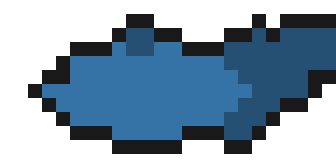

# Taarun-Koi

A GitHub Action that draws a koi fish from a GitHub account's public
activity, as a looping GIF for a profile README.

- **Size** grows with the account's total public contributions.
- **Color** is set by the account's most-used programming language (by bytes
  across its public, non-fork repositories).
- **Swim speed** picks up with the day's contribution count.

<p align="center">
  
</p>

## Usage

Copy [examples/profile-workflow.yml](examples/profile-workflow.yml) into your
GitHub profile repository (the one named after your username, e.g.
`octocat/octocat`) as `.github/workflows/koi.yml`, then embed the GIF in that
repository's `README.md`:

```html

```

Run the workflow once from the Actions tab so the first koi appears
immediately, rather than waiting for the nightly schedule.

### Inputs

| Input        | Default               | Meaning                                         |
| ------------ | ---------------------- | ------------------------------------------------ |
| `login`      | The repository owner   | Account whose koi to draw                        |
| `output-dir` | `koi`                  | Folder that receives `koi.gif` and `preview.html` |
| `token`      | The built-in token     | Token for reading the account's public data       |

## How it works

`src/collect.js` reads public data through the GitHub CLI (`gh`, preinstalled
on GitHub-hosted runners): the account's daily contribution calendar, and the
language byte totals across its public, non-fork repositories.
`src/render.js` picks the sprite sheet cell whose body color is nearest the
account's top language and whose column matches its contribution count,
crops it with [`sharp`](https://www.npmjs.com/package/sharp), and encodes a
two-frame bobbing loop as a GIF with
[`gifenc`](https://www.npmjs.com/package/gifenc), timed by the day's
contribution count.

The koi artwork itself (`assets/bodies-dark.png`) is reused from
[yalongwastaken/git-koi](https://github.com/yalongwastaken/git-koi) under its
MIT license — see [NOTICE.md](NOTICE.md). Everything else (the data
collection, color/growth matching, and animation code) is original.

## License

MIT for this repository's own code. See [LICENSE](LICENSE) and, for the
reused sprite sheet, [NOTICE.md](NOTICE.md).
